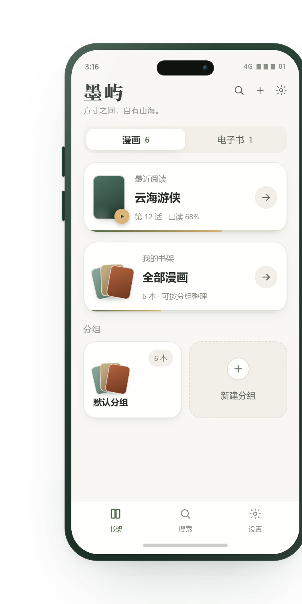
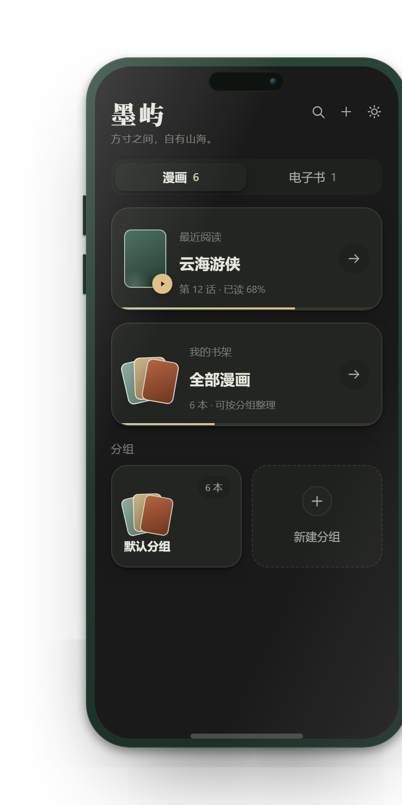

  

<h1 align="center">墨屿</h1>

  一个只想安静读书的本地阅读器。 
  不联网、不登录、不推送，也不插入广告。

  
  
  
  

---

## 界面

  
  &nbsp;&nbsp;&nbsp;
  

  书架 · 亮色 / 暗色

---

## 官网

  
  &nbsp;
  

  <strong>方寸之间，自有山海。</strong> 

---

## 功能

### 书架
- **漫画与电子书双书架**，页签随滑动切换，标题栏与搜索栏共用固定高度，展开搜索时书架不会跳动
- **分组管理**：按题材或状态分组，封面叠放展示；解散分组后书籍回到未分组，阅读进度保留
- **拖拽排序**：长按封面拖动，松手即保存
- **书名搜索**：支持一键清除，无结果时给出空状态提示
- **原文件失效可恢复**：文件被移动或删除后重新指定一次，认出同一本书，进度与书签继续保留

### 阅读
- **两种节奏**：上下连续适合条漫，左右翻页适合单页分镜，每本书可单独设置
- **缩放**：双指捏合 1×–5×，双击在 1× 与 2.5× 之间切换；放大后暂停翻页以降低内存占用
- **阅读页独立亮度**，离开阅读器即交还系统亮度
- **书签**：随手添加，调整字号后仍指向原来的位置
- **排版**：字号、行距、纸张主题统一设置，对全部电子书生效

### 性能
- 手指停止约 220 ms 后才开始预读，滑动与缩放过程中不预读
- 预读范围可调（前后各 1–3 页，默认 3 页）
- 位图缓存按设备内存自适应，退到后台即清空
- 仅保留可视区邻近页面的位图，其余立即释放

### 输入格式

| 格式 | 说明 |
| --- | --- |
| PDF | 原生 `PdfRenderer` 渲染，另用 PDFBox 提取文本层供排版与检索 |
| EPUB | 解析 OPF 元数据、封面与目录，兼容 EPUB 2（NCX）与 EPUB 3（导航文档） |
| TXT | 依次尝试 BOM、UTF-8、GBK 解码，可识别中文章节标题 |
| 图片漫画 | 图片打包成 ZIP / CBZ 导入，支持 JPG、PNG、WebP 等，按自然序排列（「第 2 话」排在「第 10 话」前面） |

---

## 隐私

- **未申请任何权限**，`AndroidManifest.xml` 中没有任何 `<uses-permission>`，包括网络权限
- `android:allowBackup="false"`，系统级备份关闭；卸载或清除数据时书架记录会一并删除，原始书籍文件不受影响
- 导入时优先引用原文件；文件提供方无法长期授权时，才在应用私有目录保存一份副本，另为书架显示复制一张封面
- 书架结构、阅读进度与书签保存在本机 Room 数据库；应用私有目录另保留最多 3 份自动快照，用于数据库损坏时恢复书架。这些数据仅墨屿可读，不联网上传，也不进入系统备份
- 移出书架只清理封面、副本与阅读记录，**不会删除原文件**

---

## 技术栈

| 项目 | 版本 / 选型 |
| --- | --- |
| 语言 | Kotlin 2.0.21 |
| 构建 | AGP 8.7.3 / Gradle Wrapper / JDK 17 |
| UI | Jetpack Compose（BOM 2024.12.01）+ Material 3 |
| 持久化 | Room 2.6.1、DataStore Preferences 1.1.1 |
| PDF 文本层 | PDFBox-Android 2.0.27.0 |
| 测试 | JUnit 4 + Robolectric 4.14.1 + Compose UI Test |
| SDK | minSdk 26（Android 8.0）/ compileSdk & targetSdk 35 |
